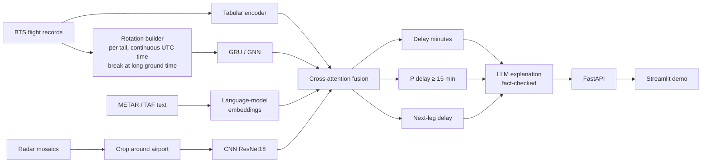

# ✈️ Multimodal Flight Disruption & Delay-Propagation Prediction

**Predict whether a flight will be delayed — and whether that delay will spread to the same aircraft's next flights — by fusing flight records, weather text, radar images and aircraft rotations, with plain-language explanations for operations teams.**

> 🚧 **Status: in progress (Phase 1 of 6).** This README describes the project design. Results, demo link and run instructions will be filled in as each phase is completed.

Part of **AeroGuard**, a multimodal AI project for safer, more efficient and more sustainable aviation, by team **CoreSix** (ESPRIT, Deep Learning — Multimodal).
**Axis:** Operational Efficiency — operational disruption risk.

---

## Table of contents
- [The problem](#the-problem)
- [What this project does](#what-this-project-does)
- [Example: input and output](#example-input-and-output)
- [Modalities](#modalities)
- [Architecture](#architecture)
- [Data sources](#data-sources)
- [How the data is linked](#how-the-data-is-linked)
- [Methodology](#methodology)
- [Evaluation](#evaluation)
- [Results](#results)
- [Demo](#demo)
- [Tech stack](#tech-stack)
- [Repository structure](#repository-structure)
- [Getting started](#getting-started)
- [Roadmap](#roadmap)
- [Related work and contribution](#related-work-and-contribution)
- [Limitations](#limitations)
- [Responsible use](#responsible-use)
- [License and data terms](#license-and-data-terms)
- [Author](#author)

---

## The problem

One aircraft flies several flights per day:

```
MIA → ATL (lands 30 min late) → ATL → JFK (leaves late) → JFK → BOS (at risk)
```

When an inbound aircraft is late, its next departure is late too. One delay becomes many — this is **delay propagation**. Combined with weather (thunderstorms, wind, low visibility) and congestion, it drives disruptions that cost airlines money, strain crews and inconvenience passengers.

Most open delay-prediction projects use a single flat table. Real disruptions depend on **several kinds of information at once**: the schedule, the aircraft's earlier flights, the weather forecast, and the storms visible on radar.

---

## What this project does

For a flight, **2 hours before its scheduled departure**, the system predicts:

1. **Departure delay** in minutes
2. **Probability of a delay ≥ 15 minutes**
3. **Propagation risk** — the expected delay of the same aircraft's next flight

…and generates a short **explanation** an operations controller can read.

**Scope:** US domestic flights operated by US airlines, departing from 10 major hubs (ATL, ORD, DFW, DEN, LAX, JFK, CLT, LAS, PHX, SEA). Training on 2024–2025, testing on 2026.

---

## Example: input and output

**Input (for one flight)**

| Input | Example |
|---|---|
| Flight info | DL1234, ATL → JFK, scheduled 14:30 local |
| Previous flight of the same aircraft | MIA → ATL, departed 30 min late |
| Weather text (METAR / TAF), origin and destination | `KATL 151852Z 25015G28KT 2SM +TSRA BKN012` |
| Radar images, origin and destination | crops around Atlanta and New York |

**Output**

```
Flight DL1234 (ATL → JFK)
Predicted departure delay: ~40 min
P(delay ≥ 15 min): 0.80

Propagation:
  → Next leg JFK → BOS: high risk (~25 min)

Explanation:
  "The aircraft is already running late from Miami and a thunderstorm
   is forecast over Atlanta at departure time. The next flight to Boston
   is also likely to be delayed."
```

*(Illustrative values.)*

---

## Modalities

| # | Modality | Data type | Source | Encoder |
|---|---|---|---|---|
| 1 | Flight records | Tabular | US BTS | MLP / FT-Transformer (XGBoost as baseline) |
| 2 | Weather reports (origin + destination) | Text (coded METAR/TAF) | Iowa Environmental Mesonet | Pretrained language model (embeddings) |
| 3 | Radar crops (origin + destination) | Image (spatio-temporal with several frames) | IEM NEXRAD mosaics | CNN (ResNet18), ViT as comparison |
| 4 | Aircraft rotation | Sequence / graph | Built from BTS tail numbers | GRU (GNN as extension) |

---

## Architecture



**Data pipeline (medallion architecture)**

```
Bronze (raw downloads) → Silver (cleaned, UTC, deduplicated) → Gold (one row per flight, all features)
```

---

## Data sources

All sources are free and public.

| Dataset | Content | Link | Update frequency |
|---|---|---|---|
| **BTS On-Time Performance** | Every US domestic flight: schedule, delays, delay causes, tail number | https://www.transtats.bts.gov/Tables.asp?QO_VQ=EFD | Monthly, published a few months later |
| **METAR** (IEM) | Hourly airport weather observations, raw text | https://mesonet.agron.iastate.edu/request/download.phtml | Near real time |
| **TAF** (IEM) | Airport weather forecasts, raw text (archive since 1996) | https://mesonet.agron.iastate.edu/request/taf.php | ~4 times per day |
| **NEXRAD radar mosaics** (IEM) | US radar composite every 5 minutes, georeferenced PNG | https://mesonet.agron.iastate.edu/docs/nexrad_mosaic/ | Every 5 minutes |
| **airportsdata** | Airport coordinates and time zones | https://pypi.org/project/airportsdata/ | Static |

Monthly BTS files can be scripted with:
```
https://transtats.bts.gov/PREZIP/On_Time_Reporting_Carrier_On_Time_Performance_1987_present_{YEAR}_{MONTH}.zip
```

> Raw data is **not stored in this repository**. Scripts download it into a local folder set in `config.yaml`.

---

## How the data is linked

Every source is joined to the flight record through a shared **key**:

| Link | Key | Rule |
|---|---|---|
| Flight → aircraft rotation | Tail number, ordered by UTC departure (across midnight) | Same aircraft over continuous UTC time; a new chain starts when the ground time exceeds a threshold chosen from the data (gap between quick turnarounds and overnight stops) |
| Flight → METAR | Airport code (`ATL` → `KATL`) + time | Last observation **at or before** the prediction moment |
| Flight → TAF | Airport code + time | Latest forecast issued **at or before** the prediction moment, valid at departure |
| Flight → radar | Airport latitude/longitude + time | Image at or before the prediction moment, cropped around the airport |
| All | — | **All timestamps converted to UTC first** |

If an aircraft's next leg does not start where the previous one ended (e.g. an international leg missing from BTS), the chain is marked **broken** and not used for propagation.

---

## Methodology

### Prediction moment
`T_pred = scheduled departure − 2 hours`. **Every feature must be known at `T_pred`.**

### Leakage prevention
- Weather is taken from the last report and latest forecast available at `T_pred` — never later.
- The previous leg's delay is used only if that leg had already departed by `T_pred`.
- BTS delay-cause columns (`LateAircraftDelay`, `WeatherDelay`, …) and the flight's own actual times are **never** used as inputs.
- **Time-based split only:** train 2024–2025 → validate early 2026 → test later 2026.
- Preprocessing is fitted on training data only.
- Automated tests check that no feature is timestamped after `T_pred`.

### Models
1. Naive baseline (known upstream delay)
2. XGBoost on tabular + parsed weather features
3. One deep encoder per modality (text, image, rotation)
4. Late fusion and cross-attention fusion with multi-task heads
5. LLM layer that **explains** predictions (it never predicts); every number it writes is checked against the model output

---

## Evaluation

| Target | Metrics |
|---|---|
| Delay minutes | MAE (overall and on storm days) |
| Delay ≥ 15 min | ROC-AUC, precision, recall, F1, calibration |
| Next-leg delay | MAE |
| Operational value | Expected cost of missed delays and false alarms (stated cost assumptions + sensitivity analysis) |

**Ablation study:** the fusion model is retrained without each modality (text, radar, rotation) to measure what each one contributes.

**Error analysis:** storm vs. clear days, airport, time of day, turnaround buffer length, worst predictions reviewed one by one.

> Accuracy alone is misleading here: most flights are on time. Precision and recall are always reported.

---

## Results

*To be completed (Phase 4).*

| Model | MAE (min) | ROC-AUC | Recall@15 | Precision@15 | Calibration | Storm-day MAE | Expected cost |
|---|---|---|---|---|---|---|---|
| Naive | – | – | – | – | – | – | – |
| XGBoost (tabular + parsed weather) | – | – | – | – | – | – | – |
| Fusion — all modalities | – | – | – | – | – | – | – |
| Fusion — without text | – | – | – | – | – | – | – |
| Fusion — without radar | – | – | – | – | – | – | – |
| Fusion — without destination inputs | – | – | – | – | – | – | – |
| Fusion — without rotation | – | – | – | – | – | – | – |

---

## Demo

*To be completed (Phases 5–6).*

| Mode | What it shows |
|---|---|
| **Replay** | A real stormy day in 2026: predictions side by side with what actually happened |
| **Live** | Today's real weather and radar, with a flight entered by the user |
| **Propagation map** | Interactive US map: an aircraft's chain of flights coloured from green to red as the predicted delay spreads |

Demo link: *coming soon*

---

## Tech stack

| Area | Tools |
|---|---|
| Language | Python 3.11+ |
| Data processing | pandas / Polars, DuckDB, Parquet, Databricks Free Edition (Spark SQL, Delta Lake) |
| Data quality | pandera |
| Machine learning | XGBoost, scikit-learn |
| Deep learning | PyTorch, torchvision, Hugging Face Transformers, PyTorch Geometric (extension) |
| Experiment tracking | MLflow |
| Explainability | SHAP, LLM-generated briefings |
| Serving and demo | FastAPI, Streamlit, pydeck (interactive propagation map) |
| MLOps | Docker, GitHub Actions (CI), pytest, ruff, pre-commit |
| Deployment | Hugging Face Spaces (Azure as an option) |
| Project management | GitHub Projects |
| Extras (planned if time allows) | Power BI dashboard, Evidently drift reports, demo video |

---

## Repository structure

```
multimodal-flight-delay-propagation/
├── README.md               # this file
├── CLAUDE.md               # detailed internal plan and coding rules
├── LICENSE
├── config.yaml             # data_dir, airports, dates, T_pred offset
├── requirements.txt
├── notebooks/              # exploration, pilot join, experiments
├── src/
│   ├── ingest/             # download scripts (BTS, METAR, TAF, radar)
│   ├── transform/          # UTC conversion, cleaning, parsing, cropping, Gold table
│   ├── features/           # rotation, weather, traffic features
│   ├── models/             # baseline, encoders, fusion
│   ├── explain/            # SHAP, LLM briefing
│   └── api/                # FastAPI service
├── app/                    # Streamlit demo
├── tests/                  # pytest: time handling, joins, leakage, API
├── docs/                   # data quality report, results, architecture
├── Dockerfile
└── .github/workflows/      # CI
```

---

## Getting started

*Run instructions will be finalised as the pipeline is built.*

```bash
# 1. Clone
git clone https://github.com/laabidi-ahmed-ai/multimodal-flight-delay-propagation.git
cd multimodal-flight-delay-propagation

# 2. Create a virtual environment
python -m venv .venv
# Windows: .venv\Scripts\activate    |   macOS/Linux: source .venv/bin/activate
pip install -r requirements.txt

# 3. Set the data folder in config.yaml (outside the repo), e.g.
#    data_dir: C:/data/flight-delay

# 4. Download data, build the dataset, train (scripts in `src/ingest/`; next phases add the pipeline and training)
```

Planned approximate storage: **~15–25 GB** (radar national images are cropped in memory and not kept; only small per-day crop files are stored).

---

## Roadmap

- [ ] **Phase 1** — Explore flight, weather and radar data; join one flight end to end; time-handling tests
- [ ] **Phase 2** — Bronze/Silver/Gold pipeline; data quality report; XGBoost baseline
- [ ] **Phase 3** — Text, image and rotation encoders
- [ ] **Phase 4** — Fusion models; ablation; error analysis
- [ ] **Phase 5** — SHAP; LLM explanations; API; Streamlit demo; Docker; CI
- [ ] **Phase 6** — Deployment; cloud architecture note; documentation; demo video; presentation

**Possible extensions:** GNN on rotations; monthly retraining with champion/challenger evaluation; additional airports.

---

## Related work and contribution

The closest work is **Aeolus: A Multi-structural Flight Delay Dataset** (Xu et al., NeurIPS 2025 — [arXiv:2510.26616](https://arxiv.org/abs/2510.26616), [code](https://github.com/Flnny/Delay-data)), which combines tabular data, flight chains and a flight network graph built from BTS and hourly weather.

This project extends that line of work by:
- adding **radar imagery** and **METAR/TAF weather text** as new modalities;
- building aircraft rotations from **real tail numbers**;
- enforcing a strict **operational prediction moment** using forecasts rather than observations;
- measuring each modality's contribution through **ablation**;
- delivering predictions with **fact-checked LLM explanations** in a **deployed product**.

---

## Limitations

- **US domestic data only.** International legs and foreign airlines are not covered; the method is designed to transfer to any airline's own data.
- **Labels arrive monthly.** BTS publishes delays a few months later, so retraining is monthly at best; live mode uses today's weather with a user-entered flight.
- **No air traffic control programmes.** Historical ground stops and ground delay programmes are not freely available.
- **Weather is not the main delay cause on most days.** Radar may help mostly on storm days; results will be reported honestly.
- **Research prototype.** Not a certified operational system.

---

## Responsible use

- Predictions are **advisory**: operations staff keep decision authority.
- Explanations are generated only from model outputs and verified facts; numbers are checked automatically.
- All data used is public and contains no personal information.

---

## License and data terms

- **Code:** MIT License (see `LICENSE`).
- **Data:** not redistributed here. Each source keeps its own terms (BTS, Iowa Environmental Mesonet, `airportsdata`). Aeolus data, if used for comparison, is CC BY-NC 4.0.

---

## Author

**Ahmed Laabidi** — team CoreSix, ESPRIT
GitHub: [@laabidi-ahmed-ai](https://github.com/laabidi-ahmed-ai)

Team CoreSix: Cyrine Mejri · Anas Ben Lajdel · Molka Mallek · Ahmed Laabidi · Kinza Chaouachi · Yassin Ben Belgacem
